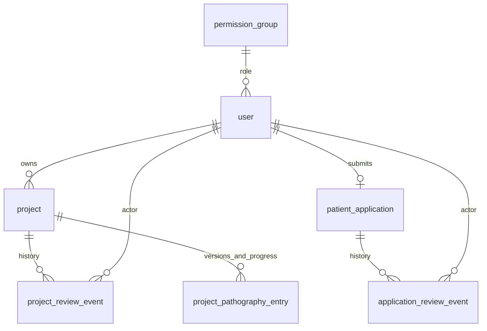

# 数据库优化说明

本说明与 `schema.sql`、`migrations/001` 至 `006` 共同更新原始数据库设计图。保留原业务状态编号和前端 API 字段；已实现的患者申请、项目申请及审核流程采用下述结构。

## 已落地的调整

| 原设计问题 | 新设计与效果 |
| --- | --- |
| 审核意见、历任志愿者、病情全部放在单行 TEXT，每次更新重写整个数组 | `application_review_event`、`project_review_event` 逐条存审核事件，`project_pathography_entry` 逐条存病情。历史增长不再触发原来 65,535 字节的整段存储上限。 |
| 项目补正覆盖旧材料和募款目标 | `project.submission_no` 标识当前提交版本，病情条目按版本保存；提交事件含当时的募款目标、病情材料和版本号。旧版本继续保留，公开页面只展示当前版本。 |
| 用户与项目、申请与审核人只有逻辑关联 | 外键保护用户角色、项目所有者、申请主体、当前审核人和事件操作者；删除采用 RESTRICT，避免连带删除业务及审核记录。 |
| `existing_projects` 与 `project_id` 可能互相矛盾，用户可能绑定别人的项目 | CHECK 保证标记与指针一致；复合外键保证指针指向该用户自己的项目。 |
| 仅在应用层限制重复创建项目 | 生成列 `active_owner_id` 只对状态不为 13 的项目返回患者 ID，唯一索引保证每位患者最多有一个未结束项目。已结项项目可保留多条。 |
| 状态、布尔标记和金额没有数据库约束 | 状态限定 0–13，布尔限定 0/1；项目金额非负、已使用金额不超过已收到金额，进入提交/审核/通过状态时目标必须大于零。金额继续使用精确十进制。 |
| 审核任务和公开列表依赖宽范围扫描 | 补充用户角色/状态、申请提交顺序、项目审核人/状态索引；公开项目按创建时间及 ID 同向倒序排列。 |

事件使用“主体 + 序号”唯一键保证顺序。领取、审核、事件写入及状态变化在同一事务中完成；写操作先锁定主体行。病情追加同样在项目行锁内分配序号，避免并发丢失。单次请求仍限制为 1 MiB，单条事件也有大小限制，历史总量不会共用原 TEXT 的 64 KiB 配额。

API 继续返回 `verification_record`、`previous_volunteers` 和 `pathography` 数组。原 TEXT 历史列保留为迁移时的原始快照，新流程不再更新它们；不要用旧列查询迁移后的新记录。历任审核人由旧列表和迁移后的领取事件组成，保留原有次序与重复领取语义。旧版项目写接口返回 HTTP 410，统一走新工作流。

项目中的姓名、年龄等字段明确作为创建时的展示快照。`user.project_id` 和布尔字段目前为兼容已有接口保留，通过约束和事务维持一致，不额外引入一套新 API。结项批准在同一事务中检查资金与待处理订单、解除用户绑定、设置项目终态 13，并保留所有历史。

## 迁移与验证

空库直接导入 `schema.sql`。已有库先备份、停止应用与所有旧写入方，再按顺序执行迁移 001 至 006（002_preflight 为只读预检），最后启动新版服务。需要 MySQL 8.0.16+，以确保 CHECK 实际执行；数据库回归已在 MySQL 8.0.46 与 MariaDB 11.8 执行。初始化和迁移需要 CREATE ROUTINE、ALTER 等结构管理权限；客户端不要使用忽略错误的 `--force` 选项。`migrations/002_preflight.sql` 依赖 001 创建的申请表，应在 001 成功后、002 执行前单独运行，检查既有数据。

002 先检查孤立关系、重复未结束项目、用户项目绑定、状态/金额以及历史 JSON。检查只输出异常类别和数量，不输出个人材料。存在异常时停止；应核对真实业务记录后修复，不能通过关闭外键检查或删除历史来跳过问题。

迁移逐条复制原审核事件和当前病情，旧病情使用版本 0；未知格式的历史事件仍保留原 JSON 内容。能解析并关联到现有用户的操作者才写入规范化外键，无法解析的历史字段留在原事件中。已经在旧系统中被覆盖的材料无法凭空恢复，新版本开始完整记录。

MySQL 的 DDL 不是事务性的。迁移用版本标记区分完成状态，并支持失败后的重跑；仍须保持停写，不能把可重复执行误当成整次原子回滚。完成后保留备份和旧列，代码回退需要配套的数据恢复方案。

数据库回归覆盖空库初始化、已有记录升级、重复运行、误用初始化脚本保护、异常数据中止及新模块约束；分别在 MySQL 8 与 MariaDB 执行。HTTP 回归覆盖审核版本、权限、资金生命周期及会话失效，浏览器测试覆盖完整操作。SQL 扫描量及列表摘要优化见 [查询性能说明](SQL查询性能说明.md)。测试仅使用独立数据库。

## 运营与资金结构（003 至 006）

- `user.account_state` 单独保存 active/frozen，冻结不覆盖患者审核状态；`session_version` 递增使旧会话失效，`phone_verified` 记录手机号验证结果。
- `notification` 存站内通知，按收件人和已读状态索引；`admin_audit` 保存管理员操作，`case_report` / `case_event` 保存举报、关联申诉和处理历史；`project_closure` 保存剩余资金方案与结项审核。
- `uploaded_file` 保存文件归属及元数据，`file_usage` 用真实外键关联申请或项目版本。文件公开资格由当前版本和项目状态判断，不依赖可修改的客户端标记。
- `payment_order`、`refund_request`、`fund_disbursement` 分开记录支付、部分退款和用款申请；各自有业务幂等唯一键，`payment_event` 按事件号和内容摘要识别重复回调。
- `project_fund_account` 保存余额、预留额和支付模式；退款/用款先预留可用余额。按项目行串行加锁，在一个事务内更新申请状态、资金流水与汇总。
- `fund_ledger` 保存已确认的有符号分录，按来源类型和来源 ID 唯一，不提供原位改写接口。项目与用户汇总均与流水在同一事务更新，对账比较流水、账户和缓存余额。

单笔金额/募款目标为 DECIMAL(10,2)，累计收款/使用款、用户累计捐赠与资金余额为 DECIMAL(14,2)。C 按整数分校验，不使用浮点数处理资金。退款上限同时受原订单未退款额度和项目可用余额限制，结项要求余额、预留额、流水净额为零且无待处理订单。

旧 `donation_ledger` 保留作历史资料，旧 `/ledger/*` 接口已停用。迁移不会将历史汇总凭空补成可用资金，存在旧汇总却没有新流水的项目由对账标为不一致，须人工核实来源后按独立迁移方案处理。开发资金和真实网关资金按项目隔离，已有模拟资金项目不能改成真实收款项目。

`schema.sql` 的新增模块来自 003 至 006；修改这些迁移后运行 `python3 tools/build_schema.py` 同步空库初始化脚本。服务接入合同、操作流程和备份要求见 [运营与服务接入](运营与服务接入.md)。
